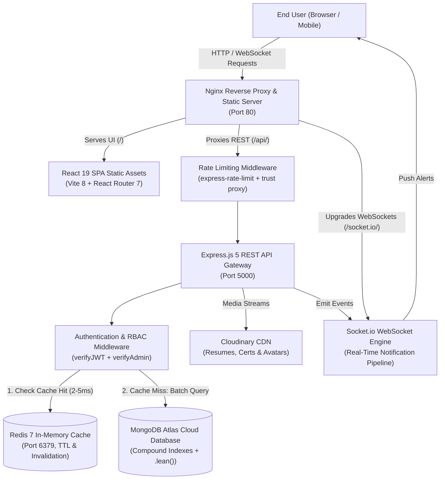

# SkillBridge

> **Student Skill Exchange & Peer Collaboration Platform**  
> Department of Computer Engineering, Faculty of Technology, Dharmsinh Desai University (DDU)  
> **Live Production URL:** [http://3.27.81.202](http://3.27.81.202) *(Deployed on AWS EC2 with Docker & Nginx)*

[](http://3.27.81.202)
[](https://www.docker.com/)
[](https://www.nginx.com/)
[](https://redis.io/)
[](https://www.mongodb.com/atlas)
[](https://socket.io/)

SkillBridge is a centralized, role-based peer learning and mentorship web application designed specifically for university campuses. It replaces scattered, informal communication channels (like unorganized WhatsApp groups and word-of-mouth requests) with an organized, verifiable, and metric-driven collaboration platform.

---

## Table of Contents

- [Live Deployment (AWS EC2)](#live-deployment-aws-ec2)
- [Performance & Scalability Optimizations (Benchmarked)](#performance--scalability-optimizations-benchmarked)
- [Problem Statement](#problem-statement)
- [Solution Overview](#solution-overview)
- [Key Features by Role](#key-features-by-role)
  - [Student (Learner)](#1-student-learner)
  - [Mentor](#2-mentor)
  - [Administrator](#3-administrator)
- [End-to-End System Workflow](#end-to-end-system-workflow)
- [System Architecture](#system-architecture)
- [Technology Stack](#technology-stack)
- [Database Models & Schema Design](#database-models--schema-design)
- [Complete REST API Reference](#complete-rest-api-reference)
- [Project Directory Structure](#project-directory-structure)
- [Installation & Deployment Guide](#installation--deployment-guide)
  - [Option A: Running with Docker Compose (Production Setup)](#option-a-running-with-docker-compose-production-setup)
  - [Option B: Running Locally (Development Setup)](#option-b-running-locally-development-setup)
- [Pre-Configured Demo Credentials](#pre-configured-demo-credentials)
- [Testing & Quality Assurance](#testing--quality-assurance)
- [Future Extensions](#future-extensions)
- [Project Credits](#project-credits)

---

## Live Deployment (AWS EC2)

SkillBridge is deployed as a fully containerized multi-service architecture running 24/7 on Amazon Web Services (AWS) in the Mumbai (`ap-south-1`) region.

* **Live Web Application:** [http://3.27.81.202](http://3.27.81.202)
* **Cloud Infrastructure:** AWS EC2 `t3.micro` instance (Ubuntu 24.04 LTS, 2 vCPUs, 1 GiB RAM, 25 GiB gp3 SSD)
* **Memory Protection:** 2.0 GiB swap memory allocation to prevent Out-Of-Memory (OOM) compilation freezes
* **Container Orchestration:** Docker Compose multi-container setup with auto-healing (`restart: always`)
* **Reverse Proxy & Routing:** Nginx Alpine serving the React SPA on Port 80, proxying REST API calls (`/api/`) to Port 5000, and upgrading WebSockets (`/socket.io/`)

```
                        ┌────────────────────────────────────────────────────────┐
                        │             AWS EC2 Cloud Server (Port 80)             │
                        │                                                        │
   User Browser ──────► │  ┌──────────────────────────────────────────────────┐  │
(http://3.27.81.202)    │  │  Nginx Reverse Proxy & Static Web Server         │  │
                        │  └───────┬──────────────────────────┬───────────────┘  │
                        │          │ (/api/ & /socket.io/)    │ (Static React)   │
                        │          ▼                          ▼                  │
                        │  ┌───────────────────────┐   ┌──────────────────────┐  │
                        │  │ Node.js Express API   │   │ Pre-Built Vite SPA   │  │
                        │  │ (Port 5000)           │   │ (/usr/share/nginx)   │  │
                        │  └───────┬───────────────┘   └──────────────────────┘  │
                        │          │ (Sub-query Cache)                           │
                        │          ▼                                             │
                        │  ┌───────────────────────┐                             │
                        │  │ Redis 7 In-Memory RAM │                             │
                        │  │ (Port 6379, 2-5ms)    │                             │
                        │  └───────────────────────┘                             │
                        └──────────┬─────────────────────────────────────────────┘
                                   │ (Persistent Atlas Connection)
                                   ▼
                        ┌──────────────────────────┐
                        │   MongoDB Atlas Cloud    │
                        └──────────────────────────┘
```

---

## Performance & Scalability Optimizations (Benchmarked)

To prepare SkillBridge for campus-scale traffic, we measured, identified, and addressed database and networking bottlenecks. Every optimization was verified and benchmarked in Postman.

### Measured Performance Gains

| Stage | Optimization Technique | Measured Latency | Total Gain |
| :--- | :--- | :---: | :---: |
| **1. Baseline (Unoptimized)** | Missing indexes, sequential N+1 database queries (61 roundtrips) | **~200 – 220 ms** | *Baseline* |
| **2. Database Tier Tuning** | Compound indexes, batch queries (`$in`), Map lookup, `.lean()` | **~100 – 120 ms** | **50% faster** |
| **3. Redis In-Memory Caching** | Sub-query caching with dynamic key hashing, TTL, and cache invalidation | **~2 – 5 ms** | **~95% faster (11x speedup!)** |

```
Query Latency (Lower is Better):
Baseline (Unoptimized):  ████████████████████ 220 ms
Indexed + Batch Query:   ██████████ 100 ms (-50%)
Redis In-Memory Cache:   █ 3 ms (-98.5%)
```

---

### Detailed Optimization Architecture

#### 1. Database Tier: Elimination of N+1 Queries & Compound Indexing
* **The Problem:** The mentor discovery catalog previously executed a `for (const mentor of mentors)` loop. If 20 mentors matched, the server fired 1 user query + 20 profile queries + 20 skill queries + 20 review counts (**61 sequential network roundtrips to MongoDB Atlas**).
* **The Solution:** Replaced iterative lookups with **3 batch queries** using `$in` arrays and mapped them in memory using JavaScript `Map` structures with $O(1)$ lookup time:
  ```javascript
  const profiles = await Profile.find({ userId: { $in: mentorIds } }).lean();
  const skills = await Skill.find({ profileId: { $in: profileIds } }).lean();
  const reviewCounts = await Review.aggregate([
      { $match: { mentorId: { $in: mentorIds } } },
      { $group: { _id: "$mentorId", count: { $sum: 1 } } }
  ]);
  ```
* **Compound Indexing:** Added composite indexes across high-traffic query filters:
  * `User`: `{ role: 1, accountStatus: 1, department: 1, academicYear: 1 }`
  * `Profile`: `{ averageRating: -1, totalReviews: -1 }`
  * `Skill`: `{ profileId: 1, skillName: 1 }` and `{ category: 1 }`
  * `Session`: `{ mentorId: 1, date: 1, time: 1, status: 1 }` and `{ studentId: 1, status: 1 }`
* **Mongoose Document Stripping (`.lean()`):** Chained `.lean()` across all read queries to bypass heavy Mongoose model hydration, reducing Node.js memory overhead by up to 70%.

#### 2. Server-Side Pagination
* Implemented limit-offset pagination (`page` and `limit`) in `mentor.controller.js` to bound query sizes (`limit = 12`).
* The backend returns structured pagination metadata (`totalMentors`, `totalPages`, `currentPage`, `hasNextPage`, `hasPrevPage`).
* Integrated with `Mentors.jsx` with Previous and Next controls, preventing mobile browser crashes and unbounded network payloads when thousands of students register.

#### 3. In-Memory Caching Tier (Redis 7)
* Integrated `ioredis` with an automated cache helper layer (`src/backend/config/redis.js`).
* **Cached Endpoints:**
  * **Mentor Catalog (`GET /api/v1/mentors`):** Cached under deterministic query filter hashes (TTL: 120s).
  * **Mentor Profile (`GET /api/v1/mentors/:id`):** Cached under `mentor:<id>` (TTL: 300s).
  * **Mentor Reviews (`GET /api/v1/reviews/mentor/:mentorId`):** Cached under `reviews:<mentorId>` (TTL: 300s).
  * **Admin Analytics (`GET /api/v1/analytics/*`):** Caches 25+ heavy aggregation and counting queries under `analytics:*` (TTL: 300s).
* **Automated Cache Invalidation:** Whenever a mentor updates their profile, adds/edits/deletes a skill, or receives a new review, the backend automatically flushes matching cache keys (`clearCachePattern("mentors:*")`, `clearCachePattern("reviews:*")`).
* **Resilient Graceful Degradation:** Configured with `enableOfflineQueue: false` and `maxRetriesPerRequest: null`. If Redis is offline or undergoing maintenance, requests instantly fail through to MongoDB Atlas with **0 ms delay and zero server crashes**.

#### 4. API Rate Limiting & DoS Protection
* Integrated `express-rate-limit` to regulate request volume:
  * **Authentication Limiter:** Max 10 attempts per 15 minutes per IP on `/login` and `/register` to stop brute-force password attacks and credential stuffing.
  * **General API Limiter:** Max 150 requests per minute per IP to mitigate Denial-of-Service (DoS) and scraping.
* Enabled `app.set("trust proxy", 1)` so Express accurately identifies the real client IP forwarded through Nginx (`X-Forwarded-For`).

---

## Problem Statement

In academic environments, learning from senior or experienced peers is one of the fastest ways to build practical engineering skills (such as React, Python, Data Structures, and Cloud deployment). However, campus peer learning faces four major bottlenecks:

1. **Lack of Skill Discoverability:** There is no verified, searchable index showing which student excels in which specific domain or technology.
2. **Buried Communication:** Help requests posted in large WhatsApp or Telegram groups get buried under unrelated messages within minutes.
3. **No Accountability or Quality Metrics:** Learners have no objective reviews, ratings, or feedback to evaluate a mentor's teaching credibility.
4. **Uncoordinated Scheduling:** Coordinating meeting dates and times informally leads to scheduling conflicts, overlapping sessions, and double-booking.

---

## Solution Overview

SkillBridge eliminates these challenges by providing:

- **Account Safety:** Enforces email validation and administrator account audits.
- **Categorized Skill Catalogs:** Standardized proficiency levels (`Beginner`, `Intermediate`, `Advanced`).
- **Parametric Mentor Search:** Multi-parameter filtering by skill keyword, department, year, and minimum rating.
- **Formal Request State Machine:** Managed lifecycle transitions (`Pending` -> `Accepted` / `Rejected` -> `Cancelled`).
- **Conflict-Free Scheduling:** Automated slot-collision engine that prevents double-booking active mentor time slots.
- **Fair Reputation System:** Post-session ratings (1.0 to 5.0 stars) automatically recalculate mentor average scores to power the university leaderboard.
- **Administrative Governance:** Complete institutional control to verify students, moderate misconduct reports, and monitor platform engagement analytics.
- **Production Scalability:** Dockerized micro-architecture with in-memory caching for sub-5ms response times.

---

## Key Features by Role

### 1. Student (Learner)
- **User Registration:** Secure sign-up with email validation and profile picture upload.
- **Parametric Discovery:** Search peers by technical skill keyword, department, academic year, and minimum rating threshold.
- **Server-Side Pagination:** Smooth pagination controls loading bounded chunks of mentor profiles.
- **Top Mentors View:** Quickly identify top-rated peers on campus sorted by verified student reviews.
- **Mentorship Requests:** Dispatch formal learning requests with personal learning objectives and notes.
- **Session Coordination:** Book 1-on-1 sessions (Online or In-Person), reschedule meeting times, or cancel sessions with automatic notification.
- **Ratings & Reviews:** Rate mentors upon session completion to contribute to the university reputation score.
- **In-App Real-Time Notifications:** Instant WebSocket alerts for request acceptances, rejections, and schedule modifications.

### 2. Mentor
- **Skill Inventory Management:** Add, update, or remove technical skills categorized under domains (Web Development, Backend, AI/ML, Core CS).
- **Profile & Credential Showcase:** Maintain bio, weekly availability schedule, portfolio link, and Cloudinary-stored resume/certificates.
- **Request Triage:** Review incoming student mentorship requests; accept or reject with a single click.
- **Conflict Prevention:** System automatically blocks double-booking if another student tries to schedule the same time slot.
- **Reputation Tracking:** View received ratings and student testimonial feedback driving their campus rank.

### 3. Administrator
- **Student Verification:** Audit newly registered students and approve verified academic accounts.
- **User Moderation:** Suspend or reactivate user accounts violating campus code-of-conduct guidelines.
- **Community Grievance Resolution:** Review reports submitted by students against abusive behavior or content; dismiss or execute account suspension.
- **Platform Analytics Engine:** Real-time visibility into registered users, active vs. suspended counts, most demanded skills, and session completion metrics powered by Redis caching.

---

## End-to-End System Workflow

SkillBridge coordinates the complete lifecycle of peer collaboration across 7 distinct phases:

### Phase 1: Authentication & Rate-Limited Security
1. The student or mentor registers with their name, email, password, department, and academic year.
2. Registration is guarded by `authLimiter` (max 10 attempts per 15 minutes).
3. The password is encrypted using 10-round salted Bcrypt hashing.
4. The user account is created with `isVerified: false`.
5. The institutional Administrator inspects pending accounts on the Admin Dashboard and approves verification.

### Phase 2: Profile & Skill Cataloging
1. The mentor navigates to their profile and sets their weekly availability schedule and bio.
2. The mentor adds technical competencies under standard categories with explicit proficiency levels.
3. Uploaded resumes and certificates are processed via Multer disk storage and streamed to Cloudinary CDN for persistent hosting.
4. Cache invalidation automatically purges any stale mentor catalog entries in Redis.

### Phase 3: Mentor Discovery & High-Speed Search Filtering
1. The learner visits the Find Mentors catalog.
2. The client calls `GET /api/v1/mentors?page=1&limit=12` with query filters.
3. Redis checks for a matching in-memory cache key.
   * **Cache Hit:** Returns pre-aggregated JSON payload in **~2–5 ms**.
   * **Cache Miss:** Queries MongoDB Atlas using compound indexes, batches profile/skill/review data in 3 queries, stores in Redis for 120s, and returns in **~100 ms**.
4. The learner can sort by rating, department, academic year, and skill.

### Phase 4: Mentorship Request Lifecycle
1. The student opens the mentor's profile and submits a learning request selecting a specific skill with an introductory note.
2. **Business Guard 1 (Self-Request Guard):** The backend verifies `studentId !== mentorId`. A user cannot request mentorship from themselves.
3. **Business Guard 2 (Duplicate Request Guard):** The server checks if an identical pending request already exists for the same skill and mentor. If found, it returns `HTTP 409 Conflict`.
4. The request is created with `status: 'pending'`, and an in-app real-time notification is dispatched to the mentor via Socket.io.
5. The mentor reviews the request in their dashboard and clicks **Accept** (status transitions to `accepted`) or **Reject** (status transitions to `rejected`).

### Phase 5: Session Scheduling & Conflict Detection
1. Once accepted, the student or mentor clicks **Schedule Session** linked to the accepted request.
2. They select the date, time, and session format (`Online` or `Offline`).
3. **Business Guard 3 (Past-Date Guard):** The server ensures the selected date and time are in the future.
4. **Business Guard 4 (Double-Booking Conflict Guard):** The backend queries the `Sessions` collection using composite index `{ mentorId: 1, date: 1, time: 1, status: 1 }` to verify whether the mentor already has an active session scheduled at that exact time slot. If an overlap is detected, the server aborts the transaction with `HTTP 409 Conflict`.
5. Participants can reschedule the session to a new slot with updated validation.
6. Once conducted, either participant clicks **Mark Completed** (`status: 'completed'`).

### Phase 6: Review & Dynamic Rating Recalculation
1. Once the session is marked completed, the student's review button unlocks.
2. **Business Guard 5 (Completed Session Requirement):** The server blocks reviews for uncompleted or scheduled sessions with `HTTP 400 Bad Request`.
3. The student submits a score (1.0 to 5.0 stars) and feedback.
4. The backend stores the new review and recalculates the mentor's arithmetic mean rating:
   $$\text{averageRating} = \frac{\sum \text{review ratings}}{\text{total reviews}}$$
5. Cache invalidator automatically purges `reviews:<mentorId>*`, `mentor:<mentorId>*`, and `mentors:*` in Redis, instantly updating leaderboard ratings.

### Phase 7: Administrative Governance & Platform Analytics
1. Any user can report inappropriate conduct or harassment via `POST /api/v1/reports`.
2. The Administrator inspects the grievance on the Admin Moderation Dashboard.
3. The Administrator can dismiss unfounded reports or suspend the reported account (`accountStatus: 'suspended'`).
4. Suspended accounts are immediately blocked from logging in with `HTTP 403 Forbidden`.
5. The Administrator inspects platform analytics (`GET /api/v1/analytics/platform-activity`) served in **~2 ms from Redis** to track platform activity, user growth, and high-demand skills.

---

## System Architecture

SkillBridge adopts a decoupled client-server architecture with in-memory caching and reverse proxying:



---

## Technology Stack

| Category | Technology | Version | Purpose & Architectural Role |
| :--- | :--- | :--- | :--- |
| **Cloud Hosting** | AWS EC2 | Ubuntu 24.04 LTS | Cloud virtual server hosting live on IP `3.27.81.202` |
| **Containerization** | Docker & Docker Compose | v29.9 / v5.6 | Multi-container orchestration, isolation, and auto-restart |
| **Reverse Proxy** | Nginx Alpine | Stable | Reverse proxy routing `/api/`, `/socket.io/`, and client-side SPA fallback |
| **In-Memory Cache** | Redis | 7.x Alpine | High-speed RAM caching layer with automated TTL and key invalidation |
| **Frontend Framework** | React.js | 19.x | Component-based client interface with reactive state |
| **Frontend Tooling** | Vite | 8.x | High-speed build engine with Hot Module Replacement |
| **Client Routing** | React Router DOM | 7.x | Declarative routing with protected role-based guards |
| **HTTP Client** | Axios | 1.20.x | Promise-based API invocations with automatic request/response interceptors |
| **Real-Time Engine** | Socket.io | 4.8.x | Bi-directional WebSocket pipeline for instant notifications |
| **Backend Runtime** | Node.js | 20.x LTS | Asynchronous, event-driven runtime environment |
| **Backend Framework** | Express.js | 5.x | Minimalist RESTful routing and middleware engine |
| **Traffic Regulation** | express-rate-limit | 8.7.x | Brute-force and DoS attack throttling middleware |
| **Redis Client** | ioredis | 5.x | Resilient Redis client with offline bypass and auto-reconnect |
| **Database** | MongoDB Atlas | Cloud | Distributed NoSQL document database with compound indexing |
| **ODM Modeling** | Mongoose | 9.x | Schema validation, relational indexing, and `.lean()` batch queries |
| **Authentication** | JSON Web Tokens (JWT) | 9.x | Dual-token security architecture (Access Token + Refresh Token) |
| **Password Hashing** | Bcrypt | 6.x | 10-round salted one-way cryptographic password hashing |
| **Media Storage** | Cloudinary SDK | 2.x | Cloud storage for profile avatars, resumes, and certificates |
| **Multipart Parsing** | Multer | 2.x | File stream handling with temporary disk cleanup |

---

## Database Models & Schema Design

Data integrity is maintained using Mongoose schemas and relational `ObjectId` references across 8 primary collections:

```
Users (1) ────────── (1) Profiles (1) ────────── (N) Skills
  │                        │
  │ (1:N)                  │ (1:N)
  ▼                        ▼
Notifications        LearningRequests (1) ────── (1) Sessions (1) ────── (1) Reviews
                            │
                            ▼
                         Reports
```

### Indexed Collections & Compound Keys
- **Users Collection:**
  - `_id`: Unique identifier (ObjectId)
  - `name`: Full student name (String, required)
  - `email`: User email address (String, unique)
  - `password`: Salted Bcrypt hash (String, required)
  - `department`: Academic branch e.g. CE, IT, EC (String, required)
  - `academicYear`: Year of study 1 to 5 (Number, required)
  - `role`: Enum (`Student`, `Mentor`, `Administrator`)
  - `profilePicture`: Cloudinary image URL (String)
  - `isVerified`: Institutional verification flag (Boolean, default: false)
  - `accountStatus`: Enum (`active`, `suspended`)
  - `refreshToken`: Stored session refresh token (String)
  - **Compound Index:** `{ role: 1, accountStatus: 1, department: 1, academicYear: 1 }`
- **Profiles Collection:**
  - `userId`: Reference to User (ObjectId, unique 1:1)
  - `bio`: Academic background summary (String)
  - `availability`: Weekly available time schedule (String)
  - `portfolioLink`: External GitHub/portfolio URL (String)
  - `resume`: Cloudinary PDF URL (String)
  - `certificate`: Cloudinary certificate URL (String)
  - `averageRating`: Arithmetic average of received reviews (Number, default: 0.0)
  - `totalReviews`: Total count of reviews received (Number, default: 0)
  - **Compound Index:** `{ averageRating: -1, totalReviews: -1 }`
- **Skills Collection:**
  - `profileId`: Reference to Profile (ObjectId, 1:N)
  - `skillName`: Competency title (String)
  - `category`: Domain category e.g. Web Dev, AI/ML (String)
  - `proficiencyLevel`: Enum (`Beginner`, `Intermediate`, `Advanced`)
  - **Indexes:** `{ profileId: 1, skillName: 1 }`, `{ category: 1 }`
- **Sessions Collection:**
  - `learningRequestId`: Reference to accepted request (ObjectId, unique 1:1)
  - `studentId`: Reference to student (ObjectId)
  - `mentorId`: Reference to mentor (ObjectId)
  - `date`: Scheduled date (Date)
  - `time`: Scheduled time string (String)
  - `mode`: Enum (`online`, `offline`)
  - `status`: Enum (`scheduled`, `completed`, `cancelled`)
  - **Compound Indexes:** `{ mentorId: 1, date: 1, time: 1, status: 1 }`, `{ studentId: 1, status: 1 }`
- **LearningRequests Collection:**
  - `studentId`: Reference to student (ObjectId)
  - `mentorId`: Reference to mentor (ObjectId)
  - `skillId`: Reference to skill (ObjectId)
  - `message`: Introductory message (String)
  - `status`: Enum (`pending`, `accepted`, `rejected`, `cancelled`)
- **Reviews Collection:**
  - `sessionId`: Reference to completed session (ObjectId, unique 1:1)
  - `studentId`: Review author (ObjectId)
  - `mentorId`: Reviewed mentor (ObjectId)
  - `rating`: Score from 1.0 to 5.0 (Number)
  - `comment`: Feedback testimonial (String)
- **Notifications Collection:**
  - `userId`: Target recipient (ObjectId)
  - `message`: Notification content (String)
  - `type`: Category indicator (String)
  - `isRead`: Read receipt status (Boolean, default: false)
- **Reports Collection:**
  - `reporterId`: User filing grievance (ObjectId)
  - `reportedUserId`: Reported user (ObjectId)
  - `reason`: Explanation of misconduct (String)
  - `status`: Resolution state (`pending`, `resolved`, `dismissed`)

---

## Complete REST API Reference

All backend API routes are prefixed with `/api/v1`.

### 1. Authentication & Users (`/api/v1/users`) : *Guarded by `authLimiter` (10 requests / 15 minutes).*
| Method | Endpoint | Access Level | Description |
| :--- | :--- | :--- | :--- |
| `POST` | `/register` | Public | Register new student/mentor with email validation & avatar |
| `POST` | `/login` | Public | Authenticate user; returns access token and sets refresh token cookie |
| `POST` | `/logout` | Authenticated | Invalidate refresh token and clear session |
| `POST` | `/refresh-token` | Public | Issue new access token using valid refresh token |
| `GET` | `/me` | Authenticated | Fetch authenticated user profile object |

### 2. Profile Management (`/api/v1/profile`)
| Method | Endpoint | Access Level | Description |
| :--- | :--- | :--- | :--- |
| `GET` | `/` | Authenticated | Retrieve current user's profile and skills |
| `PUT` | `/` | Authenticated | Update bio, availability, portfolio; upload PDF resume & certificate *(Flushes Redis Cache)* |
| `DELETE` | `/` | Authenticated | Permanently delete account with cascading cleanup of all child records |

### 3. Skill Inventory (`/api/v1/skills`)
| Method | Endpoint | Access Level | Description |
| :--- | :--- | :--- | :--- |
| `POST` | `/` | Authenticated | Add categorized technical skill with proficiency level *(Flushes Redis Cache)* |
| `GET` | `/my` | Authenticated | Retrieve all skills cataloged under current user profile |
| `PUT` | `/:id` | Authenticated | Update proficiency tier of an existing skill *(Flushes Redis Cache)* |
| `DELETE` | `/:id` | Authenticated | Delete a skill record from user profile *(Flushes Redis Cache)* |

### 4. Discovery & Mentors (`/api/v1/mentors` & `/api/v1/students`) : *High-speed in-memory responses powered by Redis (2–5 ms latency).*
| Method | Endpoint | Access Level | Description |
| :--- | :--- | :--- | :--- |
| `GET` | `/mentors` | Authenticated | Search & filter mentors (`search`, `department`, `academicYear`, `page`, `limit`) |
| `GET` | `/mentors/:id` | Authenticated | View detailed mentor profile with verified reviews and skills |
| `GET` | `/students` | Authenticated | Browse active university student profiles |
| `GET` | `/students/:id` | Authenticated | View individual student profile details |

### 5. Learning Requests (`/api/v1/learning-requests`)
| Method | Endpoint | Access Level | Description |
| :--- | :--- | :--- | :--- |
| `POST` | `/` | Student | Create learning request (self-request and duplicate guards active) |
| `GET` | `/my` | Student | Retrieve outgoing requests dispatched by current student |
| `GET` | `/received` | Mentor | Retrieve incoming requests received by current mentor |
| `PATCH` | `/:id/accept` | Mentor | Accept pending request; unlocks session scheduling (dispatches Socket.io notification) |
| `PATCH` | `/:id/reject` | Mentor | Reject incoming request with automatic notification |
| `PATCH` | `/:id/cancel` | Student | Cancel student's own pending request |

### 6. Session Coordination (`/api/v1/sessions`)
| Method | Endpoint | Access Level | Description |
| :--- | :--- | :--- | :--- |
| `POST` | `/` | Authenticated | Schedule session for accepted request (double-booking check active) |
| `GET` | `/my` | Authenticated | List all upcoming and historical sessions for current user |
| `PATCH` | `/:id/reschedule` | Authenticated | Reschedule date & time with future-slot validation |
| `PATCH` | `/:id/complete` | Authenticated | Mark conducted session completed; unlocks review eligibility |
| `PATCH` | `/:id/cancel` | Authenticated | Cancel scheduled session |

### 7. Reviews & Ratings (`/api/v1/reviews`)
| Method | Endpoint | Access Level | Description |
| :--- | :--- | :--- | :--- |
| `POST` | `/` | Student | Submit 1.0 to 5.0 star review; recalculates mentor average rating *(Flushes Redis Cache)* |
| `GET` | `/mentor/:mentorId` | Authenticated | Fetch all student reviews and feedback for specific mentor *(Cached in Redis)* |
| `GET` | `/my` | Authenticated | Fetch reviews authored by current student |
| `DELETE` | `/:id` | Authenticated | Remove review and trigger mentor rating re-aggregation *(Flushes Redis Cache)* |

### 8. Notifications (`/api/v1/notifications`)
| Method | Endpoint | Access Level | Description |
| :--- | :--- | :--- | :--- |
| `GET` | `/my` | Authenticated | Fetch all notifications for current user |
| `PATCH` | `/:id/read` | Authenticated | Mark notification as read |
| `DELETE` | `/:id` | Authenticated | Delete notification |

### 9. Administration & Moderation (`/api/v1/admin` & `/api/v1/reports`)
| Method | Endpoint | Access Level | Description |
| :--- | :--- | :--- | :--- |
| `GET` | `/admin/users` | Admin | Retrieve all registered users with verification and suspension status |
| `PATCH` | `/admin/users/:id/verify` | Admin | Approve and verify student account |
| `PATCH` | `/admin/users/:id/suspend` | Admin | Suspend user account for code-of-conduct violation |
| `PATCH` | `/admin/users/:id/activate` | Admin | Reactivate suspended user account |
| `DELETE` | `/admin/users/:id` | Admin | Administratively remove a user account |
| `POST` | `/reports` | Authenticated | Submit grievance report against user or content |
| `GET` | `/reports/pending` | Admin | Fetch unhandled moderation reports |
| `PATCH` | `/reports/:id` | Admin | Moderate report (`suspend`, `remove`, `resolve`) |
| `PATCH` | `/reports/:id/dismiss` | Admin | Dismiss report without penalty |

### 10. Platform Analytics Engine (`/api/v1/analytics`) : *Guarded by Redis 5-minute caching to eliminate database aggregation load.*
| Method | Endpoint | Access Level | Description |
| :--- | :--- | :--- | :--- |
| `GET` | `/user-statistics` | Admin | Total users, student/mentor ratios, 30-day growth curve |
| `GET` | `/popular-skills` | Admin | Top 10 requested skills with student demand counts |
| `GET` | `/platform-activity` | Admin | Comprehensive platform activity (requests, sessions, reviews) |

---

## Project Directory Structure

```
SkillBridge1/
├── docker-compose.yml              # Production multi-service orchestrator (Backend + Frontend + Redis)
├── package.json                    # Root workspace package orchestrator
├── package-lock.json
├── README.md                       # Master architectural and deployment documentation
└── src/
    ├── backend/                    # Node.js + Express 5 REST API Engine
    │   ├── Dockerfile              # Production Node 20 Alpine container image
    │   ├── .dockerignore
    │   ├── server.js               # Entry point, socket.io initialization, trust-proxy & routes
    │   ├── package.json            # Backend dependencies (ioredis, express-rate-limit, socket.io)
    │   ├── .env.example            # Environment configuration template
    │   ├── config/
    │   │   ├── db.js               # MongoDB Atlas connection handler
    │   │   ├── redis.js            # Resilient ioredis client with failover & cache helpers
    │   │   └── socket.js           # Socket.io WebSocket server & notification emitter
    │   ├── controllers/            # Optimized business logic controllers
    │   │   ├── admin.controller.js
    │   │   ├── analytics.controller.js      # Cached platform analytics
    │   │   ├── learningRequest.controller.js
    │   │   ├── mentor.controller.js         # Batched, indexed, paginated & cached mentor discovery
    │   │   ├── notification.controller.js
    │   │   ├── profile.controller.js        # Profile management & cache invalidation
    │   │   ├── report.controller.js
    │   │   ├── review.controller.js         # Review logic & cache invalidation
    │   │   ├── session.controller.js
    │   │   ├── skill.controller.js          # Skill inventory & cache invalidation
    │   │   ├── student.controller.js
    │   │   └── user.controller.js
    │   ├── middlewares/            # Security interceptors
    │   │   ├── admin.middleware.js          # Verifies Administrator role
    │   │   ├── auth.middleware.js           # Verifies JWT Bearer token
    │   │   ├── rateLimiter.middleware.js    # Auth & API rate limiters
    │   │   └── multer.js                   # Multipart stream parser
    │   ├── models/                 # Mongoose schemas with compound indexes
    │   │   ├── LearningRequest.js
    │   │   ├── Notification.js
    │   │   ├── Profile.js
    │   │   ├── Report.js
    │   │   ├── Review.js
    │   │   ├── Session.js
    │   │   ├── Skill.js
    │   │   └── User.js
    │   ├── routes/                 # Express API routes
    │   └── utils/                  # Wrappers & utilities (ApiError, ApiResponse, Cloudinary)
    │
    └── skillbridge-frontend/       # React 19 + Vite Single Page Application
        ├── Dockerfile              # Multi-stage production container (Node 20 builder -> Nginx Alpine)
        ├── .dockerignore
        ├── nginx.conf              # Reverse proxy for /api/ & /socket.io/ + SPA routing fallback
        ├── index.html
        ├── vite.config.js
        ├── package.json
        └── src/
            ├── App.jsx             # React Router 7 setup with ProtectedRoute guards
            ├── main.jsx            # React root mounting
            ├── index.css           # Global design system & responsive styling
            ├── components/         # Reusable UI elements (Navbar, ProtectedRoute)
            ├── context/            # AuthContext & SocketContext for real-time alerts
            ├── pages/              # 17 application views (Mentors, Dashboards, Sessions, Reviews)
            └── services/
                ├── api.js          # Axios client with automatic JWT token refresh interceptor
                └── socket.js       # Client-side Socket.io connector
```

---

## Installation & Deployment Guide

### Option A: Running with Docker Compose (Production Setup)

This is the exact production architecture running live on AWS EC2. It boots the frontend, backend, and Redis in isolated containers with a single command.

#### 1. Prerequisites
- Docker Engine installed (v24.x or newer)
- Docker Compose plugin installed (`docker compose version`)

#### 2. Configure Backend Environment
Create `src/backend/.env`:
```env
PORT=5000
CORS_ORIGIN=*
REDIS_URL=redis://redis:6379
MONGO_URI=mongodb+srv://<username>:<password>@cluster0.mongodb.net/SkillBridge?retryWrites=true&w=majority
ACCESS_TOKEN_SECRET=your_super_secret_access_key
ACCESS_TOKEN_EXPIRY=1d
REFRESH_TOKEN_SECRET=your_super_secret_refresh_key
REFRESH_TOKEN_EXPIRY=10d
CLOUDINARY_CLOUD_NAME=your_cloudinary_name
CLOUDINARY_API_KEY=your_cloudinary_key
CLOUDINARY_API_SECRET=your_cloudinary_secret
```

#### 3. Build and Launch Containers
From the project root directory, run:
```bash
docker compose up -d --build
```

#### 4. Access the Live Application
* **Frontend Web Application:** [http://localhost](http://localhost) (or `http://<YOUR_EC2_IP>` on AWS)
* **Backend REST API:** [http://localhost:5000](http://localhost:5000)
* **Redis In-Memory Cache:** `localhost:6379`

#### 5. Useful Docker Management Commands
```bash
# View real-time logs across all services
docker compose logs -f

# View backend logs specifically
docker compose logs -f backend

# Check container status and port bindings
docker compose ps

# Stop all containers
docker compose down
```

---

### Option B: Running Locally (Development Setup)

If you wish to develop without running containers for the application code:

#### 1. Start Redis in the Background
```bash
docker compose up -d redis
```
*(If Redis is not running, the backend automatically degrades to direct MongoDB queries without crashing).*

#### 2. Install Dependencies
```bash
# Root
npm install

# Backend
cd src/backend && npm install

# Frontend
cd ../skillbridge-frontend && npm install

# Return to root
cd ../..
```

#### 3. Run Frontend & Backend Concurrently
From the root directory:
```bash
npm run dev
```

* **Frontend:** http://localhost:5173
* **Backend:** http://localhost:5000

---

## Pre-Configured Demo Credentials

For quick evaluation across all three platform roles:

| Role | Permissions & Capabilities |
| :--- | :--- |
| **Student** | Discover mentors, dispatch learning requests, schedule sessions, write reviews |
| **Mentor** | Manage offered skills, accept/reject requests, coordinate sessions, build reputation score |
| **Administrator** | Audit & verify student accounts, suspend bad actors, moderate reports, view real-time platform analytics |

---

## Testing & Quality Assurance

SkillBridge is backed by a formal verification suite of **36 System Test Cases** (`TC-01` to `TC-36`) covering functional requirements, security boundaries, and edge cases:

- **Brute-Force & DoS Throttling:** Verified that hitting `/login` more than 10 times in 15 minutes returns `HTTP 429 Too Many Requests`.
- **Cache Hit / Miss Verification:** Verified that `GET /api/v1/mentors` drops from ~100 ms (`X-Cache: MISS`) on first call to 2–5 ms (`X-Cache: HIT`) on subsequent calls.
- **Cache Invalidation Integrity:** Verified that updating a mentor profile or submitting a new review immediately purges Redis keys so students never see stale data.
- **RBAC Security Boundaries:** Verified that student tokens attempting to access `/api/v1/admin/*` endpoints strictly receive `HTTP 403 Forbidden`.
- **Slot Collision & Double-Booking Prevention:** Backend actively queries active mentor schedules to reject overlapping session bookings with `HTTP 409 Conflict`.
- **Integrity Constraints:** Prevents self-mentorship requests, blocks duplicate pending requests, and disallows reviews on uncompleted sessions.
- **Cascading Deletions:** Deleting a user account cascades removal across their profile, cataloged skills, session bookings, and reviews to prevent orphan database documents.
- **Dual-Token Auto-Refresh:** Axios response interceptors catch `HTTP 401 Unauthorized` and transparently renew expired access tokens via `/users/refresh-token`.

---

## Future Extensions

- **In-Browser Video Conferencing (WebRTC):** Integrate 1-click peer-to-peer audio/video calls directly within the session interface.
- **AI-Powered Mentor Matching:** Vector embeddings matching learners with mentors based on course syllabus, past projects, and learning history.
- **Two-Way Calendar Sync:** Automatic synchronization with Google Calendar and Microsoft Outlook for session reminders.
- **Cryptographic Skill Badges:** Issuance of verifiable digital credentials upon faculty endorsement or peer assessment completion.
- **Cross-Platform Mobile Application:** Native iOS and Android mobile app using React Native.

---

## Project Credits

- **Developer:** **Parth Dani**
- **Department:** Department of Computer Engineering, Faculty of Technology
- **Institution:** **Dharmsinh Desai University (DDU)**, Nadiad
- **Academic Year:** 2026 – 2027

Built for collaborative student peer learning at Dharmsinh Desai University.
